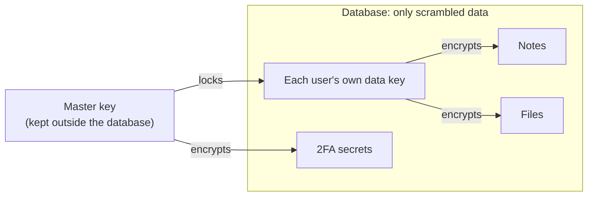
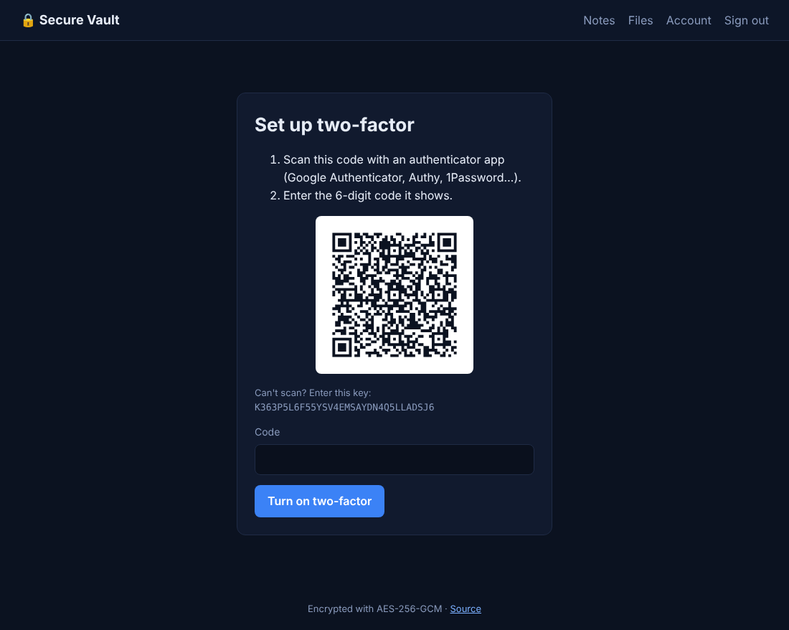

# Secure Vault

[](https://github.com/funsoi-hub/secure-vault/actions/workflows/ci.yml)
[](https://github.com/funsoi-hub/secure-vault/actions/workflows/security.yml)


A place to keep the things you really don't want leaked (recovery codes, passwords, private documents), built so that even a stolen database gives an attacker nothing but noise.

**Live demo:** _coming soon_ · **Threat model:** [secure-vault-threat-model](https://github.com/funsoi-hub/secure-vault-threat-model) · **CI security gate:** [devsecops-pipeline](https://github.com/funsoi-hub/devsecops-pipeline)


## Why I built this

In my day-to-day security work I spend a lot of time *finding* problems in other people's applications: running SAST and DAST scans, reading reports, writing up fixes. I wanted to see the other side: build an application myself, make every security decision deliberately, and prove each one works.

So I picked something where security is the whole point, a vault for secrets, and followed it through the full development life cycle: threat model first, then the code, then a pipeline that blocks anything risky from shipping.

## What it does

- **Encrypted notes and files.** Everything you store is encrypted *before* it reaches the database, including titles and file names.
- **Two-factor sign-in.** Works with any authenticator app (Google Authenticator, Authy, 1Password).
- **Share links that expire.** Share a note read-only for 1 hour to 7 days, cap how many times it can be opened, and revoke it whenever you like.
- **Security activity log.** You can see every sign-in, failed attempt, share and download on your account, with the IP address.

## How the encryption works

I used **envelope encryption**, the same idea AWS and Google Cloud use for their key management services:



In plain terms:

1. Every user gets their own random encryption key.
2. That key is itself locked with a master key that **never touches the database**.
3. So a stolen database is useless on its own: the attacker would also need the master key from the server's environment.

I also bound each piece of encrypted data to its owner. If someone with database access copied my encrypted note into their own account, decryption would fail instead of revealing it. [There's a test proving that.](tests/test_vault.py)

## Security decisions, mapped to the OWASP Top 10

The [OWASP Top 10 (2025)](https://owasp.org/Top10/2025/) is the industry's list of the most common web app risks. Here's how I handled each one, with the test that proves it:

| OWASP risk | What I did | Proven by |
|---|---|---|
| **A01 Broken Access Control** | Every lookup is scoped to the signed-in user. Guessing someone else's note ID returns "not found", and IDs are random, not 1, 2, 3… | `test_users_cannot_read_or_change_each_others_notes` |
| **A02 Security Misconfiguration** | Strict browser security headers: no scripts at all (CSP), no framing, HTTPS-only (HSTS), no caching. The app refuses to start in production without real keys. | `test_security_headers_present` |
| **A03 Software Supply Chain** | Exact dependency versions, automatic update PRs, and a CI gate that scans every dependency and the Docker image | [security workflow](.github/workflows/security.yml) |
| **A04 Cryptographic Failures** | Argon2id for passwords, AES-256-GCM for data. Session and share tokens are stored only as hashes. | `test_notes_encrypted_at_rest` |
| **A05 Injection** | Parameterised database queries only, and auto-escaped HTML backed up by a "no scripts" policy | `test_stored_xss_is_escaped` |
| **A06 Insecure Design** | Threat-modelled before building. Share links can't be "used up" by chat apps previewing them, because opening one needs a real click. | `test_share_link_respects_view_limit` |
| **A07 Authentication Failures** | Two-factor sign-in with replay protection, lockout after 5 wrong passwords, rate limits, and identical errors whether or not an account exists | `test_mfa_required_after_enabling` |
| **A08 Data Integrity Failures** | Tampered data fails to decrypt instead of being trusted. Every form is protected against cross-site request forgery. | `test_tampered_ciphertext_detected` |
| **A09 Logging & Alerting Failures** | Security events are logged with IP addresses and shown to the user. Passwords and secrets are never logged. | `test_account_locks_after_repeated_failures` |
| **A10 Mishandling Exceptional Conditions** | Errors fail closed with a generic message. Request size, upload size and every input are limited. | `test_oversized_request_rejected` |

All **37 security tests** run automatically on every change.

## Security at every stage of development

| Stage | What I did |
|---|---|
| **Plan** | Wrote the security requirements first: encrypted at rest, two-factor, owner-only access, revocable sharing, a full audit trail |
| **Design** | Built a [threat model](https://github.com/funsoi-hub/secure-vault-threat-model) before coding: 35 threats, each linked to the control that stops it |
| **Build** | Secure defaults in code, a small set of dependencies, every version pinned |
| **Test** | 37 security tests, plus my [CI security gate](https://github.com/funsoi-hub/devsecops-pipeline): code scanning, secret scanning, dependency and container scanning, and a live attack scan with OWASP ZAP |
| **Release** | A small Docker image that runs as a non-root user, with OS patches applied and no package manager inside |
| **Operate** | Weekly re-scans catch newly published vulnerabilities, and Dependabot opens update PRs |

### The gate caught something on day one

On its very first run, my security gate **blocked this repo** over 5 high-severity vulnerabilities in the Docker image. They weren't in my code; they were inside pip's own bundled libraries in the Python base image. The app never installs anything at runtime, so I removed pip from the final image entirely. The gate went green, and the image got smaller and safer in the process.

## Try it yourself

**Run it locally** (needs Python 3.12+):

```bash
git clone https://github.com/funsoi-hub/secure-vault.git
cd secure-vault
python -m venv .venv
source .venv/bin/activate          # Windows: .venv\Scripts\activate
pip install -r requirements-dev.txt

# Local development mode (plain http, throwaway keys)
COOKIE_SECURE=false uvicorn app.main:create_app --factory --reload
# Windows PowerShell:  $env:COOKIE_SECURE="false"; uvicorn app.main:create_app --factory --reload
```

Then open http://127.0.0.1:8000. Run the tests with `pytest`.

**Deploy your own copy for free:**

[](https://render.com/deploy?repo=https://github.com/funsoi-hub/secure-vault)

This creates the service with random keys stored by Render, not in the code. On the free plan the app sleeps when idle and the demo data resets on restart.

**Run it with Docker (production mode):**

```bash
cp .env.example .env        # then generate the two keys as described in the file
docker build -t secure-vault .
docker run --env-file .env -p 8000:8000 -v vault-data:/data secure-vault
```

## Screenshots

| Notes | Setting up two-factor | Security activity |
|---|---|---|
|  |  |  |

## What I learned

- **Encryption is mostly about key management.** AES itself is the easy part. Deciding where keys live, how they're wrapped and how they'd be rotated is where the real design work is.
- **"It works" isn't the same as "it's secure".** Writing a test for each control forced me to think like an attacker: what happens if I change this ID, replay this code, or swap this data?
- **Small details matter.** Things like chat apps "opening" links to show previews, or share tokens leaking through the `Referer` header, only surfaced because I threat-modelled first.

## Known limitations

I'd rather be upfront about these than hide them:

- **The server can decrypt your data**, because it holds the master key. That protects against a database leak, but not against someone who fully controls the server. Encrypting in the browser (end-to-end) is the next big step.
- **Rate limits are kept in memory**, so they only apply per server process. Running more instances would need a shared store like Redis.
- **The sign-up form reveals whether an email is already registered.** It's rate-limited, and the sign-in form doesn't reveal it.

## What's next

- [ ] End-to-end encryption in the browser
- [ ] Email verification and password reset
- [ ] Ship the audit log to tamper-proof external storage

## Project layout

```
app/
  main.py       pages, access checks, CSRF protection
  security.py   passwords, sessions, two-factor, rate limiting, audit log
  crypto.py     envelope encryption (AES-256-GCM)
  models.py     database tables (encrypted data only)
  config.py     settings, which refuse to start without keys in production
tests/          37 security tests
```

---

Built by **Funso Isola** · [LinkedIn](https://linkedin.com/in/funisola) · [More projects](https://github.com/funsoi-hub)

Found a security issue? See [SECURITY.md](SECURITY.md). Licensed under [MIT](LICENSE).
