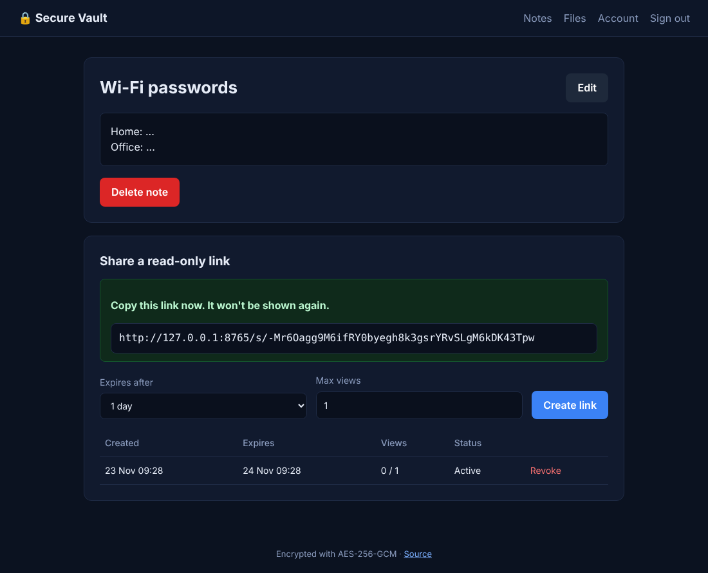
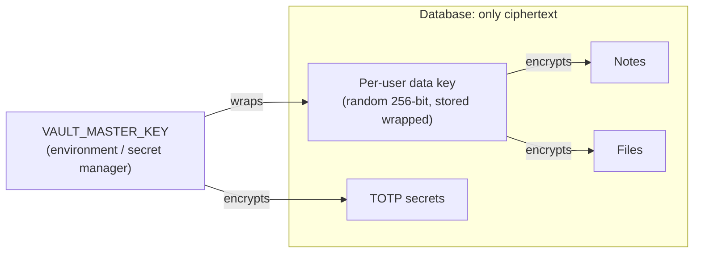
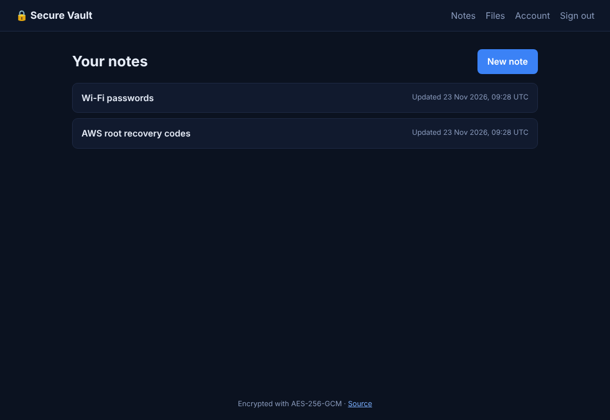
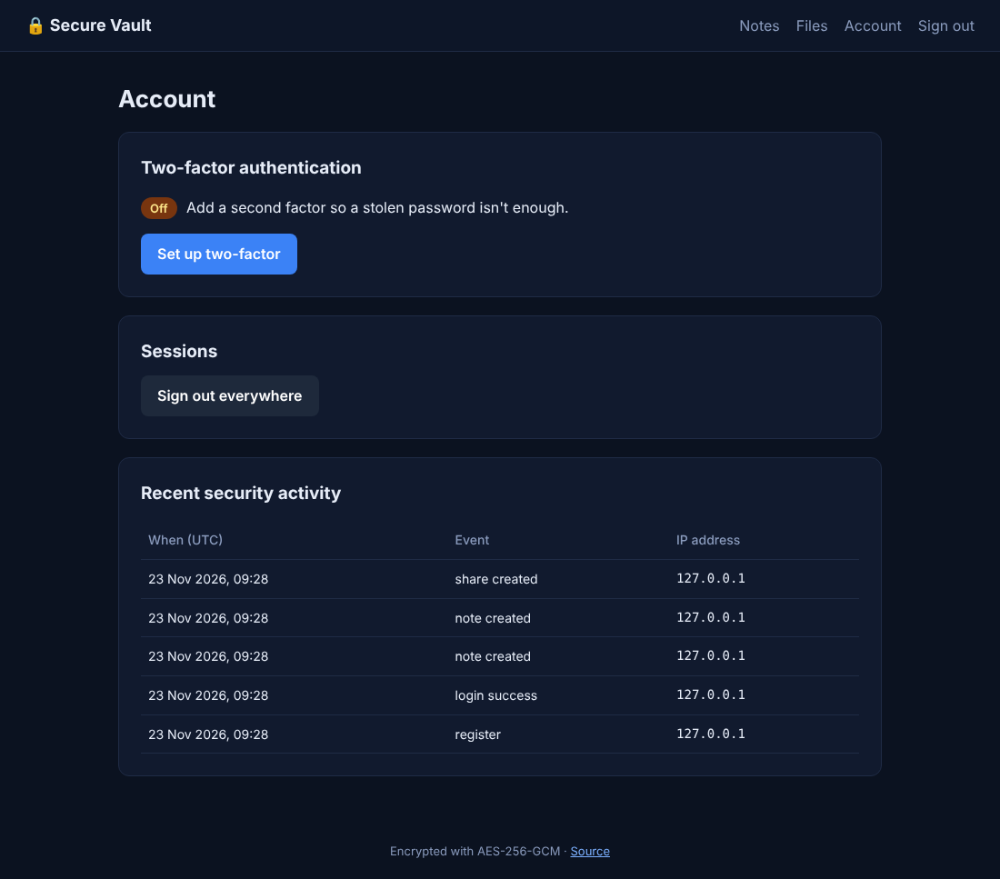

# Secure Vault

[](https://github.com/funsoi-hub/secure-vault/actions/workflows/ci.yml)
[](https://github.com/funsoi-hub/secure-vault/actions/workflows/security.yml)


An encrypted notes and file vault, built end to end with security designed in at every stage of the software development life cycle (SDLC), not bolted on afterwards.

**Live demo:** _coming soon_ · **Threat model:** [secure-vault-threat-model](https://github.com/funsoi-hub/secure-vault-threat-model) · **CI security gate:** [devsecops-pipeline](https://github.com/funsoi-hub/devsecops-pipeline)



## What it does

- **Encrypted notes and files.** Everything a user stores (note titles, bodies, file names and contents) is encrypted with AES-256-GCM before it touches the database.
- **Two-factor sign-in.** TOTP codes from any authenticator app, with replay protection.
- **Expiring share links.** Share a note read-only with a link that expires after 1 hour to 7 days and a set number of views, and revoke it any time.
- **Security activity log.** Users see every sign-in, failed attempt, share and download on their account page.

## How the encryption works

Envelope encryption, the same pattern AWS KMS and Google Cloud KMS use:



- **One master key, many data keys.** A stolen database alone is useless: every data key is wrapped by a master key that lives only in the environment. Rotating the master key means re-wrapping small keys, not re-encrypting every note.
- **AES-256-GCM with a fresh random nonce per encryption**, so tampering is detected rather than silently decrypted.
- **Associated data binds each ciphertext to its owner and field** (`note:<user>:<note>:body`). Someone with database write access can't copy Alice's ciphertext into Mallory's row to read it. [There's a test for exactly that.](tests/test_vault.py)

## Security controls, mapped to the OWASP Top 10:2025

| OWASP 2025 | Risk | How Secure Vault handles it | Test |
|---|---|---|---|
| A01 | Broken Access Control | Every query is scoped to the signed-in owner. Another user's ID returns 404, not 403, so IDs reveal nothing. IDs are random 128-bit values, not counters. | `test_users_cannot_read_or_change_each_others_notes` |
| A02 | Security Misconfiguration | Strict CSP (`script-src 'none'`), HSTS, `X-Frame-Options: DENY`, `nosniff`, `Referrer-Policy: no-referrer`, `Cache-Control: no-store`. API docs disabled. Refuses to start in production without real keys. | `test_security_headers_present` |
| A03 | Software Supply Chain Failures | Pinned dependencies, Dependabot, and a CI gate that scans dependencies and the container image. Every GitHub Action is pinned to a commit SHA. | [security gate](.github/workflows/security.yml) |
| A04 | Cryptographic Failures | Argon2id password hashing, AES-256-GCM envelope encryption, keys from the environment, session and share tokens stored only as SHA-256 hashes. | `test_notes_encrypted_at_rest` |
| A05 | Injection | SQLAlchemy parameterised queries only. Jinja2 auto-escaping plus a CSP that blocks all script. | `test_stored_xss_is_escaped` |
| A06 | Insecure Design | Threat-modelled before building ([STRIDE + ATT&CK](https://github.com/funsoi-hub/secure-vault-threat-model)). Share links can't be burned by link-preview bots, because viewing needs a deliberate click (POST). | `test_share_link_respects_view_limit` |
| A07 | Authentication Failures | TOTP MFA with replay protection. Account lockout after 5 failures. Per-IP rate limits. Identical errors and timing for unknown users. Session ID rotated at login and after MFA. Idle and absolute timeouts. | `test_mfa_required_after_enabling` |
| A08 | Software or Data Integrity Failures | GCM authentication tags make tampered ciphertext fail closed. Signed double-submit CSRF tokens on every form, plus an `Origin` check. | `test_tampered_ciphertext_detected` |
| A09 | Security Logging & Alerting Failures | Audit log of sign-ins, failures, lockouts, MFA changes, shares and downloads, with IP addresses, shown to the user. Passwords and secrets are never logged. | `test_account_locks_after_repeated_failures` |
| A10 | Mishandling of Exceptional Conditions | Decryption errors fail closed with a generic message. Request size limits, upload size limits, and strict input validation on every field. | `test_oversized_request_rejected` |

There are 37 automated security tests in [`tests/`](tests/). Each control above is checked in CI on every change.

## Security across the SDLC

| Stage | What was done |
|---|---|
| **Requirements** | Security requirements written up front: data encrypted at rest, MFA, owner-only access, revocable sharing, auditability. |
| **Design** | [Threat model](https://github.com/funsoi-hub/secure-vault-threat-model) with a data-flow diagram, STRIDE per component, and attack paths mapped to MITRE ATT&CK. Each threat links to the control that addresses it. |
| **Build** | Secure defaults in code (above). Small dependency set, every version pinned. Ruff with flake8-bandit rules in the editor and CI. |
| **Test** | 37 security unit tests, plus a [reusable CI security gate](https://github.com/funsoi-hub/devsecops-pipeline): Semgrep + Bandit (SAST), Gitleaks (secrets), Trivy (dependencies, image, Dockerfile) and OWASP ZAP (DAST). **A high-severity finding fails the build, and the ruleset blocks merging into `main`.** |
| **Release** | Multi-stage Docker image running as a non-root user, OS packages patched at build time, health check, no server banner. |
| **Operate** | Weekly scheduled scan catches new CVEs in unchanged code. Dependabot opens update PRs. The audit log gives users visibility of account activity. |

## Run it locally

```bash
git clone https://github.com/funsoi-hub/secure-vault.git && cd secure-vault
python -m venv .venv && source .venv/bin/activate   # Windows: .venv\Scripts\activate
pip install -r requirements-dev.txt

# Plain-http dev mode: random keys, non-Secure cookies
COOKIE_SECURE=false uvicorn app.main:create_app --factory --reload
# Windows PowerShell:  $env:COOKIE_SECURE="false"; uvicorn app.main:create_app --factory --reload
```

Open http://127.0.0.1:8000, then run the tests with `pytest`.

### Deploy your own (free)

[](https://render.com/deploy?repo=https://github.com/funsoi-hub/secure-vault)

[`render.yaml`](render.yaml) creates the service with random keys stored by Render, not in git. On the free plan the app sleeps when idle and the demo data resets on restart.

### With Docker (production mode)

```bash
cp .env.example .env    # then generate the two keys as described in the file
docker build -t secure-vault .
docker run --env-file .env -p 8000:8000 -v vault-data:/data secure-vault
```

Production needs HTTPS in front (most hosts provide it), because session cookies are `Secure`.

## Project layout

```
app/
  main.py       routes, middleware, CSRF, access checks
  security.py   Argon2id, sessions, TOTP, rate limiting, audit log
  crypto.py     envelope encryption (AES-256-GCM)
  models.py     database models (ciphertext only)
  config.py     settings from environment, fail-closed in production
tests/          37 security-focused tests
```

## Known limitations

These are on purpose, documented rather than hidden:

- **Rate limits are in memory**, so they apply per process. With several workers, move them to Redis.
- **The server can decrypt user data**, because it holds the master key. That protects against a database leak, not against a fully compromised server. End-to-end (client-side) encryption is the next step and is on the roadmap.
- **Registration reveals whether an email is already registered.** This is accepted and rate-limited. The login form doesn't reveal it.

## Screenshots

| Notes | Two-factor setup | Security activity |
|---|---|---|
|  |  |  |

## Licence

MIT. See [LICENSE](LICENSE). Found a vulnerability? See [SECURITY.md](SECURITY.md).
